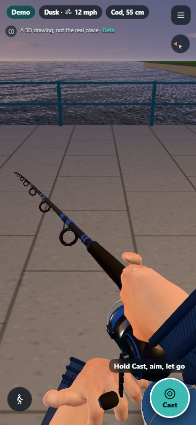
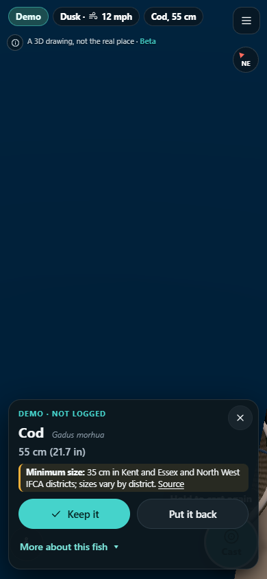
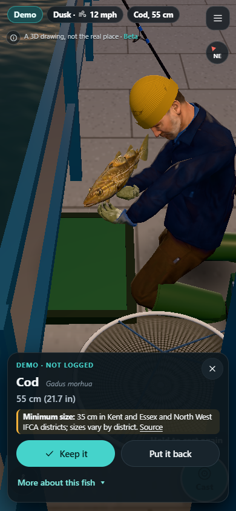

# Fishing flow and water polish

Based on main at `d378dfe`. The recent flow-walk, flow-reel and flow-landing work is preserved. This pass fixes control ownership, animation continuity and water shading rather than replacing those systems.

## Changes

- Camera gestures distinguish pinches and cancellations from taps. Losing focus, losing pointer capture, hiding the page or removing the view cancels pending taps and held movement. W remains releasable if Shift is released first.
- Flick inertia uses the exact integral of decaying velocity so it travels the same distance at different frame rates. Resuming the page resets the frame delta.
- A new fight clears the previous reel's momentum so its hand cannot overshoot and reverse. The HUD handle uses continuous angles instead of wrapping backwards every full turn. Keyboard repeat cannot generate extra reel taps or repeated jumps.
- Strike and Land pulse a halo while their touch targets stay stationary. Cast cancels on lost capture or focus; the joystick resets on lost capture.
- The fish-inspection camera rises above deck rail height before moving across from the net, avoiding the post that could fill the screen during the transition.
- Water microdetail is filtered using pixel footprint, with broader texture retained. Rotated noise gradients now shade in the correct direction. Splash foam uses defined, ascending smoothstep edges.
- Idle splash particles are hidden and skip buffer uploads. Ripple output arrays are reused between frames.

## Validation

- Baseline: 296 unit tests passed. Changed build: 305 passed.
- Data validation and production build passed. No new dependencies or third-party assets.
- Phone-size Chromium check: no uncaught JavaScript exceptions or shader errors, no horizontal page overflow.
- Reproduced focus bug: baseline kept walking at 1.8 m/s for two seconds after focus left the canvas. Changed version decelerated to 0 m/s (about 0.23 m stopping distance).
- Eight individual reel taps registered eight taps/four turns. Landing, fish inspection and release returned to the Cast control. The demo's existing “Land it now” button skips the remainder of the fight; this is not a test of fight balance or every landing frame.
- Both supplied recordings were sampled with Blender's video decoder. The live site was visually inspected separately. The local browser checks use the representative fallback pier because the local preview does not provide the live location services.

## Before / after

Same 390 × 844 viewport, quality setting and camera direction. The animated water is sampled at slightly different times.

| Before | After |
| --- | --- |
|  |  |

Inspection transition, approximately one second after opening the fish card (the animation timing is not frame-locked):

| Before camera fix | After camera fix |
| --- | --- |
|  |  |

## Scope and remaining checks

Software-rendered browser timings are not measurements of real iPhone performance. This pass reduces specific idle rendering work; it does not claim an FPS gain. Real-device multi-touch, native Safari, the reconstructed live pier and Fish Together need hands-on acceptance before release. No backend or multiplayer protocol code changed.

Blender is accessible on this PC and was used in a separate background process to review the supplied videos. Existing open asset projects were not edited. No replacement models or downloaded assets are included; the existing licensing records remain applicable.

Reproduce locally with `node --test tests/*.test.js`, `node tools/check-data.mjs`, `npm run build`, and the two scripts below against a local preview:

```text
node tools/polish-audit.mjs http://127.0.0.1:4173 audit/polish
node tools/fishing-flow-audit.mjs http://127.0.0.1:4173 audit/fishing
```

The browser scripts require the repository's existing Playwright dependency and its Chromium browser. Use `--baseline` for the first script when intentionally checking the old build's failing behaviour. No merge or production deployment is authorised by this report.
