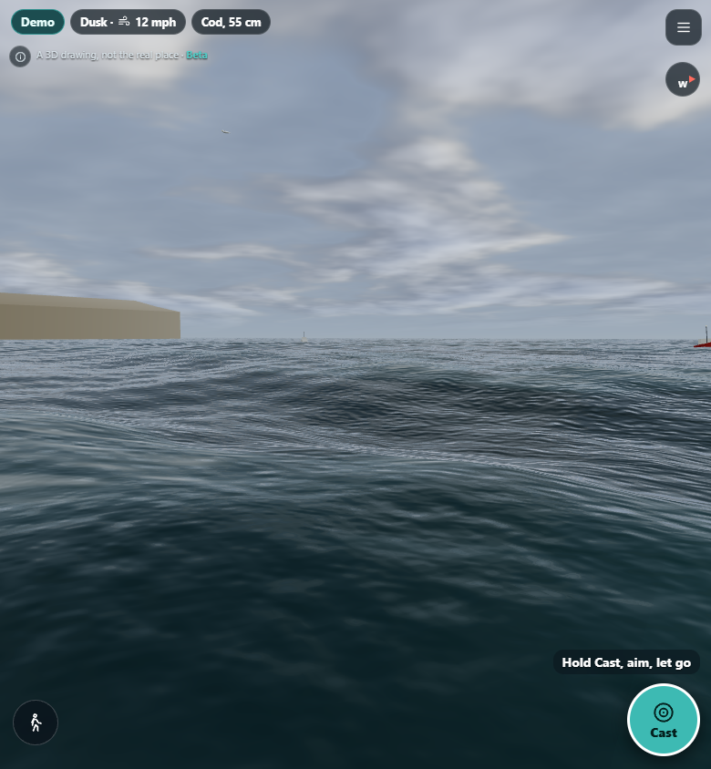
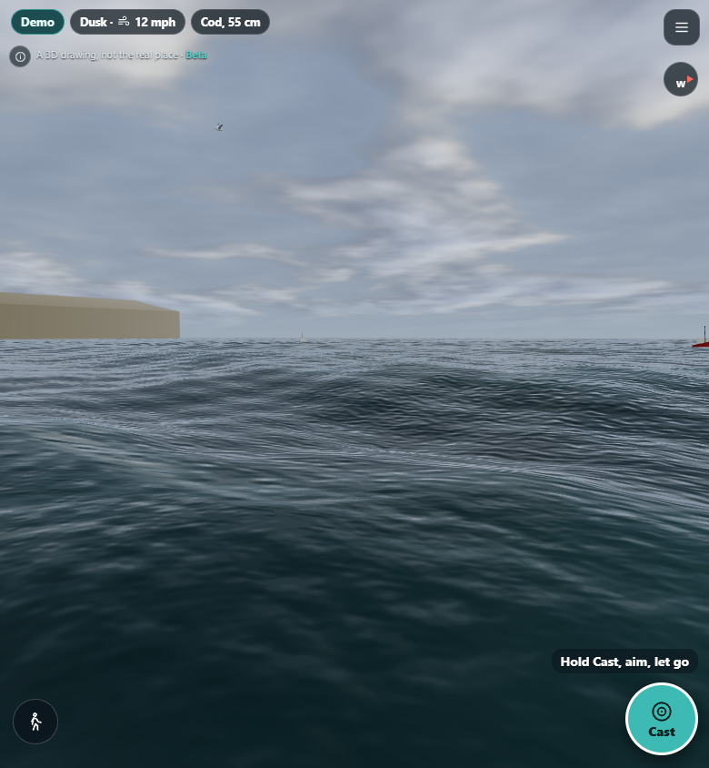
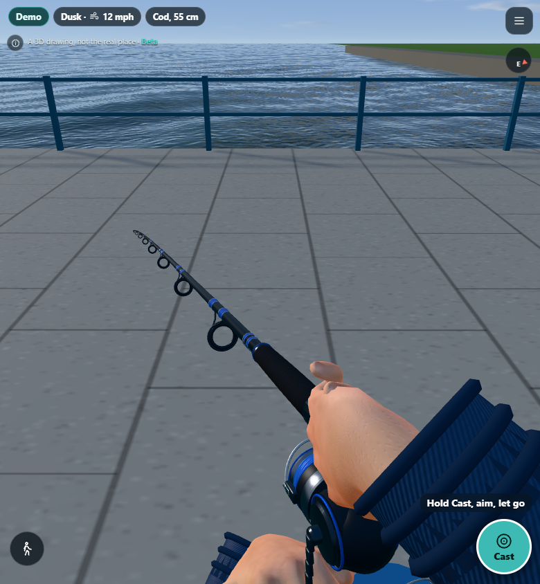
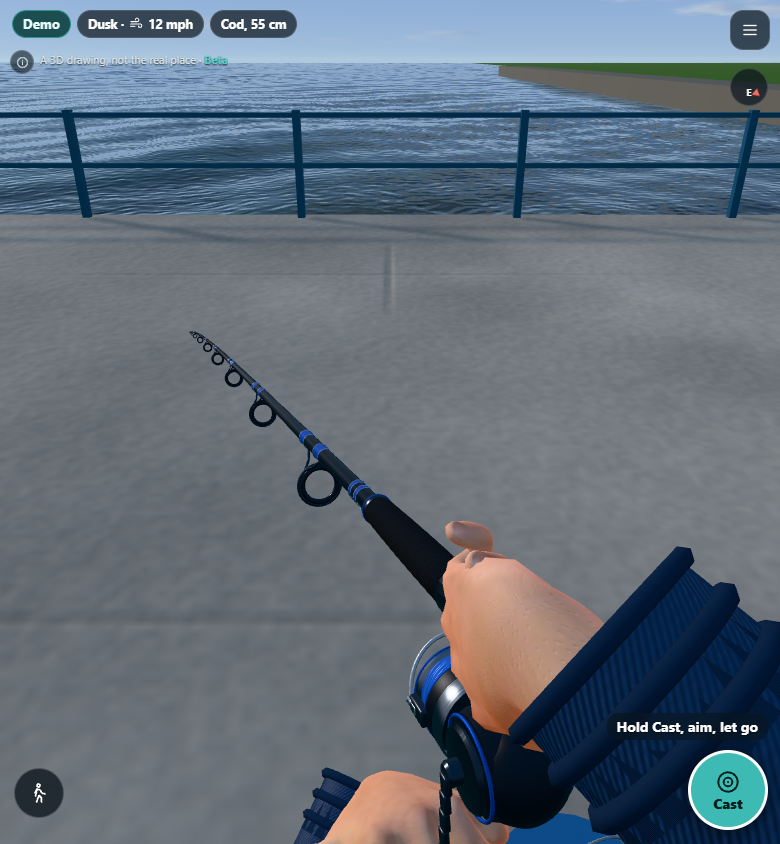

# Sea and environment graphics pass

Follow-up to the controls/camera polish in PR #40.

- Whitecaps break into irregular patches on exposed wave crests, with less continuous pale banding.
- Shore foam drifts with the wind; unresolved small bubbles blend out instead of flickering.
- Broader variations in water colour suggest changing depth/current. Distant reflections and sun glitter soften with the pixel footprint.
- Representative piers use the existing procedural concrete colour, normal and roughness maps, at an eight-metre tile scale instead of stretched paving textures. Rain darkens the concrete and reduces its roughness.
- Fixed an impossible condition that suppressed all expansion joints in the shared concrete generator; joints are narrow and shallow.
- Dispose the new normal and roughness textures with the environment. No new downloads, assets or dependencies.

## Evidence

| Previous pass | This pass |
| --- | --- |
|  |  |
|  |  |

Same camera/viewport and specified weather, sampled at slightly different animation times. The audit uses the existing rendering test hook to set weather; the demo's top-bar weather label does not change with that hook. Local scenes use the representative fallback pier.

## Checks

305 unit tests, data validation and the production build passed. Balanced and Performance modes rendered daylight, rough weather, dusk and night without observed JavaScript exceptions or shader errors. The sampled sea view retains the same draw-call and triangle counts as the previous build; fragment shading changed and concrete adds two texture maps. This is not a real-phone FPS measurement.

Reproduce with the existing Playwright dependency and Chromium:

```text
node tools/sea-audit.mjs http://127.0.0.1:4173 audit/sea balanced
node tools/sea-audit.mjs http://127.0.0.1:4173 audit/sea-performance performance
```

Production deployment still requires Aaron's explicit approval.
